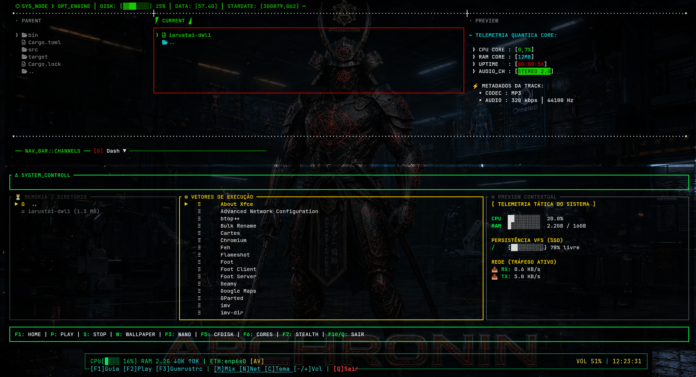
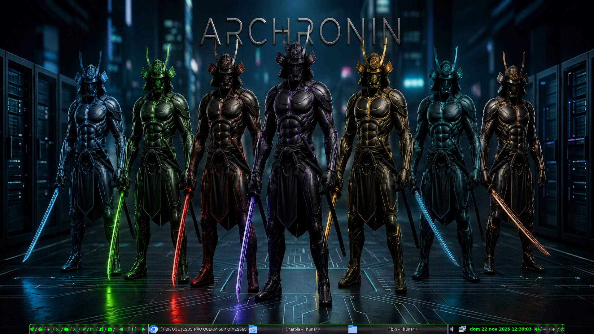
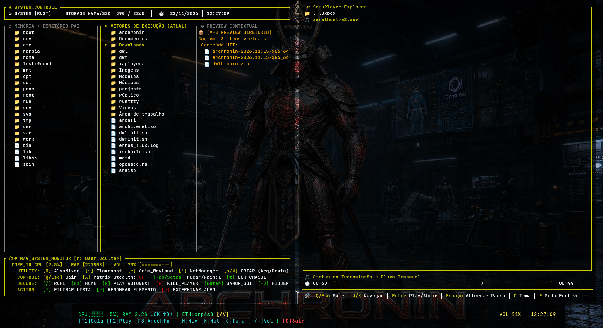

# Ψ ArchRonin Linux

Distribuição minimalista baseada em **Arch Linux**, focada em leveza extrema, zero bloat e fluxo rápido no terminal.

**Fluxbox (X11)**, **dwl (Wayland)** e **5 perfis TUI**.

<div align="center">
  
</div>

---

## 📸 Preview

| Matrix & Boot | Profile DWL 5 (`Sigma`) | System & TUI |
| :---: | :---: | :---: |
|  |  |  |

---

## ◈ Destaques
* **Fluxbox (X11)** & **dwl (Wayland)** na mesma ISO.
* **5 Perfis TUI (`iarustai-dwl1` a `5`)** pré-compilados, testáveis no modo Live e selecionáveis na instalação via **PROFGUM**:
  * **Alpha (`dwl1`):** Gumrustrc + ArchonPlayer
  * **Beta (`dwl2`):** IAFM + IAPlayerAI
  * **Gamma (`dwl3`):** Protognum + ArchonPlayer
  * **Omega (`dwl4`):** Omnifm + ArchonPlayer
  * **Sigma (`dwl5`):** Arcchfm + SamuPlayer
* **Sem Display Manager pesado:** Login direto no TTY com guia completo no **MOTD** (`startx`, `start-archronin` ou `rusttty`).

---

## ◈ Download & Verificação
* **Download da ISO (Internet Archive):** [Baixar ArchRonin 2026.11.21 (x86_64)](https://archive.org/details/archronin-2026.11.15-x86_64)
* **Download via Torrent:** [archronin-2026.11.15-x86_64_archive.torrent](https://archive.org)

* **SHA256:**
  ```text
  c8d1c011ffa619892b8ac7f69599504086e4202564a0d88b99094c213aee07dd  archronin-2026.11.21-x86_64.iso
  ```

---

## ◈ Notas da Build Beta (`2026.11.21`)
* **LabTUI Arsenal (seleção manual de TUIs extras):** A seleção múltipla dentro do menu *LabTUI* está em ajuste para a próxima build. O perfil escolhido na instalação (`Alpha` a `Sigma`) já instala automaticamente a sua TUI principal e os seus players no SSD; caso queira alguma ferramenta extra da ISO, basta copiá-la manualmente de `/usr/local/bin` para `/mnt/usr/local/bin` (ou via Thunar).

---

## ◈ Feedback & Bugs (Beta)
Encontrou algum erro ou tem sugestão de melhoria? Abra uma issue na aba **[Issues](https://github.com)**.
